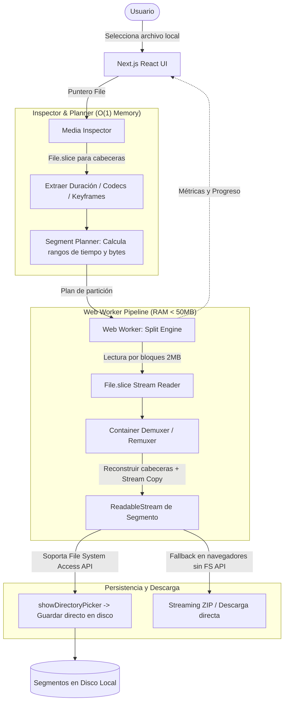

# Media Splitter

*   **Author:** Antigravity & User
*   **Status:** Approved
*   **Date:** 2026-11-05

--------------------------------------------------------------------------------

## Overview

Media Splitter es una aplicación web estática y de ejecución 100% en el cliente (Client-Side WebApp), optimizada para su despliegue sin servidor en **Vercel** y control de versiones en **GitHub**. Su objetivo es permitir a los usuarios dividir archivos de audio y video de tamaño arbitrario (desde pocos megabytes hasta decenas de gigabytes) en segmentos definidos por duración temporal, tamaño en megabytes/gigabytes o número fijo de partes.

La aplicación opera íntegramente dentro del navegador del usuario sin subir ningún byte a servidores externos, garantizando privacidad total, costo de infraestructura cero y compatibilidad con el límite de 4.5 MB de las funciones serverless de Vercel.

## The Problem

Los usuarios frecuentemente necesitan segmentar grabaciones extensas (podcasts, clases grabadas, transmisiones en vivo, metraje de cámara) para enviarlas por plataformas con límites de tamaño (WhatsApp, Discord, correo, almacenamiento compartido) o para archivar porciones de interés.

Las soluciones actuales presentan graves deficiencias:
1. **Herramientas web tradicionales:** Exigen subir el archivo completo a servidores en la nube. Con archivos de 5 GB a 50 GB, esto demanda horas de subida, falla ante microcortes de red, consume ancho de banda y expone la privacidad del usuario.
2. **Servicios serverless estándar (Vercel/Cloud):** Poseen cuotas de carga útil estrictas (máximo 4.5 MB en Vercel) y tiempos de ejecución efímeros, haciendo imposible el procesamiento backend de medios masivos.
3. **Herramientas de escritorio complejas:** Editores no lineales (Premiere, DaVinci) o comandos CLI (FFmpeg) requieren instalación local, configuración técnica y conocimientos avanzados de codecs y GOPs.
4. **Colapso de memoria en navegadores:** La mayoría de herramientas web en navegador intentan cargar el archivo completo en memoria (`FileReader.readAsArrayBuffer`), provocando cierres inesperados por falta de memoria (OOM / Out of Memory) en archivos grandes.

Media Splitter resuelve este problema mediante una heurística de acceso en streaming directo (`File.slice()` y Web Streams) que mantiene el consumo de memoria RAM constante y por debajo de 50 MB, independientemente del tamaño del archivo original.

## Goals

*   **G-1 (Despliegue Serverless & GitHub):** La aplicación debe construirse como un frontend estático (Next.js / React / TypeScript) desplegable directamente en Vercel con un clic y con repositorio limpio y estructurado en GitHub.
*   **G-2 (Procesamiento 100% Local / Zero-Upload):** Ningún dato multimedia debe transmitirse por la red; todo el procesamiento ocurre en el navegador del cliente.
*   **G-3 (Huella de Memoria Constante < 50 MB):** Procesamiento de archivos de cualquier tamaño mediante particionado en bloques (chunked streaming con `File.slice()`), sin almacenar el archivo completo en memoria en ningún momento.
*   **G-4 (Formatos Web Estándar):** Soporte garantizado para los formatos más comunes de video (MP4, MOV, WebM) y audio (MP3, WAV, AAC, OGG).
*   **G-5 (Modos de Partición Flexibles):** Capacidad de dividir por:
    - Intervalo de tiempo (ej. cada X minutos o segundos).
    - Límite de tamaño (ej. partes de máximo X MB con tolerancia ±5%).
    - Número de partes iguales (ej. dividir en N partes).
*   **G-6 (Dualidad de Corte Informada):**
    - *Corte Rápido (Lossless Stream Copy):* Instantáneo, sin recodificación, cortando en puntos clave (Keyframes / Sync Samples) para formatos compatibles.
    - *Corte Exacto (Al segundo):* Recorte preciso al frame/segundo con advertencia clara de tiempo de procesamiento.
*   **G-7 (Descarga Eficiente de Segmentos):** Entrega de las partes resultantes mediante File System Access API (escritura directa a disco sin retener en RAM) con fallback a descarga secuencial y empaquetado ZIP en streaming.

## Non-Goals

*   **NG-1 (Procesamiento en Servidor / Cloud Functions):** No se ejecutará transcodificación en el backend de Vercel ni se almacenarán archivos en servidores remotos.
*   **NG-2 (Edición No Lineal Compleja):** No se implementarán efectos de video, transiciones, subtitulado avanzado ni edición multipista.
*   **NG-3 (Decodificación de Códecs Propietarios Obsoletos):** No se garantizará soporte para formatos legados o cerrados que no posean decodificadores web nativos (ej. WMV antiguo, RealMedia, Indeo Video).

## Open Questions

*   **Q-1**: ¿Cómo optimizar la generación del archivo ZIP si el usuario procesa 50 partes y el navegador no soporta File System Access API?  
    *Estrategia:* Uso de streaming ZIP (`client-zip`) que escribe los datos a medida que se generan, liberando memoria inmediatamente.

## Critical User Journeys (CUJs)

### CUJ 1: División rápida de video MP4 por tamaño para mensajería
*   **Given**: Un usuario tiene un video MP4 de 4.2 GB y necesita enviarlo por una plataforma que admite un máximo de 500 MB por archivo.
*   **When**: Abre la webapp en Vercel, selecciona o arrastra el archivo, elige "Dividir por tamaño (500 MB)", selecciona "Corte Rápido" y pulsa "Procesar".
*   **Then**: La aplicación calcula los puntos de corte en keyframes sin recodificar, genera las 9 partes correspondientes en pocos segundos con un consumo de RAM menor a 50 MB, y las guarda directamente en la carpeta seleccionada por el usuario.

### CUJ 2: División de audio largo (podcast/clase) por tiempo
*   **Given**: Un usuario tiene una grabación de audio MP3 de 3 horas y desea dividirla en bloques de 30 minutos.
*   **When**: Arrastra el archivo MP3, selecciona "Dividir por tiempo (30 min)", y hace clic en "Procesar".
*   **Then**: La aplicación extrae los paquetes de audio sincronizados en streaming, genera los 6 archivos MP3 con sus cabeceras reconstruidas, y permite descargarlos individualmente o en lote.

--------------------------------------------------------------------------------

## Technical Plan (Architecture)

### 1. High-Level Architecture Overview

Media Splitter está estructurada en tres capas desacopladas dentro del navegador del usuario:
1. **Capa de Presentación e Interacción (UI Thread):** Componentes React (Next.js App Router) para selección de archivo, configuración de particionado (tiempo, tamaño, partes), visualización de metadatos, estimación de almacenamiento y monitorización de telemetría en tiempo real.
2. **Capa de Orquestación y Sondeo (`Inspector & Planner`):** Analizadores ligeros de cabeceras que leen únicamente los primeros y últimos bloques de bytes del archivo (`File.slice()`) para obtener duración, codecs, tabla de keyframes y bitrate nominal sin cargar el flujo multimedia.
3. **Capa de Ejecución en Streaming (`Worker & Writers`):** Un Web Worker dedicado ejecuta el bucle de división en un hilo de fondo. Lee paquetes por bloques (`File.slice()`), reconstruye los metadatos de contenedor (cabeceras MP4/WebM/WAV) y canaliza los bytes hacia el sistema de archivos local (`FileSystemWritableFileStream`) o al descargador en streaming.

### 2. Component Breakdown

#### A. `MediaInspector` (Inspección Rápida de Medios)
- **Objetivo:** Obtener metadatos críticos (duración en segundos, bitrate promedio, resolución, canales de audio y tabla de sync samples/keyframes) en menos de 500 ms sin leer el cuerpo del archivo (`mdat`).
- **Mecanismos por Formato:**
  - **MP4 / MOV:** Lee los primeros bytes buscando `ftyp`. Si `moov` está al inicio, lo parsea directamente. Si está al final del archivo (típico en grabaciones de cámara), utiliza `file.slice(file.size - 10 * 1024 * 1024)` para localizar el átomo `moov` al final. Lee la tabla `stss` (Sync Sample Box) para conocer los timestamps exactos de los fotogramas clave.
  - **WebM / Matroska:** Lee los primeros 128 KB para parsear el encabezado EBML, el elemento `Info` (duración/TimecodeScale) y busca el elemento `Cues` para mapear keyframes a offsets de byte.
  - **MP3:** Lee la cabecera ID3v2 (si existe) y busca el primer frame sync `0xFFE` / `0xFFF`. Parsea el encabezado MPEG (MPEG-1/2 Layer III, bitrate, sample rate, padding) y cabecera Xing/VBR si está presente para calcular duración total y bitrate promedio.
  - **WAV:** Parsea la cabecera RIFF de 44 bytes para extraer canales, frecuencia de muestreo y tamaño del bloque `data`. La duración y offsets se obtienen matemáticamente en tiempo $O(1)$.

#### B. `SegmentPlanner` (Heurística de Planificación y Tolerancia)
- **Modos de Cálculo:**
  1. **Por Tiempo ($T_{\text{chunk}}$):** Divide la duración total $D$ en fragmentos de longitud $T$. En modo *Corte Rápido*, cada punto de corte $T_i$ se ajusta (snap) al keyframe más cercano previo para garantizar reproducción limpia.
  2. **Por Tamaño ($S_{\text{max}}$):** Con base en el bitrate promedio $B$, estima la duración $T \approx S_{\text{max}} / B$. Aplica un margen de seguridad de -5% para garantizar que fluctuaciones de bitrate variable (VBR) no excedan el tamaño solicitado por el usuario. En modo *Corte Rápido*, se alinea al keyframe adyacente dentro del margen de tolerancia.
  3. **Por Número de Partes ($N$):** $T = D / N$, aplicando el mismo ajuste a keyframes en modo rápido.

#### C. `StreamSplitterWorker` (Motor de Segmentación en Web Worker)
- **Objetivo:** Ejecutar la extracción y re-empaquetado sin bloquear la interfaz gráfica.
- **Estrategia de Memoria Constante:**
  - El worker no almacena en memoria los segmentos completos. Opera mediante un pipeline de flujo (`ReadableStream` / `TransformStream`).
  - Para cada segmento planificado:
    1. Genera la cabecera reconstruida del contenedor (ej. un nuevo `moov` para MP4 adaptando la duración, las pistas y corrigiendo los offsets en `stco`/`co64`).
    2. Lee los datos multimedia del rango correspondiente usando `file.slice(startOffset, endOffset)` en bloques de 2 MB a 4 MB.
    3. Emite los fragmentos directamente hacia el escritor de disco.
    4. El garbage collector del motor JS libera el bloque anterior inmediatamente, manteniendo la memoria total ocupada por debajo de 50 MB en todo momento.

#### D. `DiskWriter` (Guardado de Archivos Eficiente)
- **Modo Preferente:** `window.showDirectoryPicker()`. El usuario selecciona una carpeta de destino una sola vez. Cada segmento se escribe mediante un `FileSystemWritableFileStream` a medida que se generan los bytes.
- **Modo Fallback:** Si la API del sistema de archivos no está soportada (ej. Firefox o Safari en ciertas versiones), se utiliza un empaquetador ZIP en streaming (`client-zip`) que descarga un único archivo comprimido sin comprimir de nuevo los datos (método Store), emitiendo el stream directamente al navegador.

### 3. Resource Optimization Heuristics

| Recurso | Estrategia de Optimización | Métrica de Éxito |
|---|---|---|
| **Memoria RAM** | Punteros `File.slice()` con buffers de transmisión de 2-4 MB en Web Worker. | Consumo < 50 MB constante para archivos de 100 MB a 100 GB. |
| **CPU / Hilos** | Procesamiento offload en Web Worker. En *Corte Rápido*, coste de CPU cercano a cero (copia de bytes puros). | 60 FPS estables en la interfaz gráfica durante todo el proceso. |
| **Ancho de Banda** | 100% de ejecución en el cliente. 0 bytes transmitidos hacia o desde servidores. | 0 MB consumidos de la cuota serverless de Vercel. |
| **Almacenamiento Local** | Escritura streaming directa sin duplicación de archivos temporales. | Espacio adicional requerido = 0 (solo el tamaño de los segmentos finales). |

--------------------------------------------------------------------------------

## Alternatives Considered

### Alternative A: Procesamiento Backend Serverless en Vercel
*   **Pros:** Permite el uso de utilidades nativas estándar en Node.js/Python en el servidor.
*   **Cons:** Restricción insalvable de 4.5 MB en la carga útil (`request body`) de funciones de Vercel, tiempo máximo de ejecución acotado (15-60s), almacenamiento efímero `/tmp` de 512 MB, y costo excesivo de ancho de banda y latencia para el usuario al subir archivos de 5 a 50 GB.
*   **Reason for Rejection:** Técnicamente inviable para archivos de tamaño indefinido bajo el modelo serverless de Vercel.

### Alternative B: FFmpeg compilado a WebAssembly en el Navegador (`ffmpeg.wasm`)
*   **Pros:** Admite prácticamente cualquier códec y comando tradicional de FFmpeg dentro del navegador.
*   **Cons:** WebAssembly está limitado por el espacio de direcciones de 32 bits (máximo 2 a 4 GB de memoria por pestaña); la carga de archivos masivos en el sistema de archivos virtual (`MEMFS`) genera fallos de falta de memoria (`Out of Memory - OOM`) inmediatos; además, el paquete de inicialización pesa decenas de megabytes.
*   **Reason for Rejection:** Incompatible con la premisa de "tamaño de archivo original indefinido" sin colapsar el navegador.

### Alternative C: Aplicación de Escritorio Nativa (Electron / Tauri / PyQt)
*   **Pros:** Acceso sin restricciones al hardware local, binarios de FFmpeg del sistema y sistema de archivos sin permisos especiales de navegador.
*   **Cons:** Requiere empaquetado por sistema operativo (instaladores `.exe`, `.dmg`), instalación manual por parte del usuario, y no permite el acceso web instantáneo a través de una URL alojada en Vercel.
*   **Reason for Rejection:** No cumple con el requerimiento de estar disponible y accesible directamente en Vercel.

--------------------------------------------------------------------------------

## Implementation Plan

### Phase 1: Estructura del Proyecto & Despliegue en GitHub/Vercel
- Inicialización de la aplicación Next.js con TypeScript, Tailwind CSS y Lucide Icons.
- Configuración para exportación estática compatible con Vercel (`output: 'export'` o SPA estática) garantizando que no requiera cómputo de servidor.
- Configuración de repositorio Git: `.gitignore`, `README.md` exhaustivo con instrucciones de uso y despliegue, y `LICENSE` (MIT).

### Phase 2: Motor de Inspección y Particionado en Streaming
- `src/lib/types.ts`: Definición de interfaces para metadatos (`MediaMetadata`), opciones de partición (`SplitConfig`), plan de segmentos (`SegmentPlan`) y telemetría (`JobProgress`).
- `src/lib/inspector.ts`: Algoritmos de lectura ligera por rangos con `File.slice()` para extraer duración y metadatos de MP4, WebM, MP3 y WAV sin cargar el archivo completo.
- `src/lib/planner.ts`: Planificador heurístico que traduce las solicitudes de tiempo, tamaño y número de partes a intervalos de offsets y timestamps, aplicando tolerancia de -5% para flujos VBR y alineación a keyframes.
- `src/lib/worker/splitter.worker.ts`: Web Worker que implementa la tubería de particionado en segundo plano por bloques de 2-4 MB.
- `src/lib/writer.ts`: Gestor de salida que canaliza los segmentos directamente a disco mediante `showDirectoryPicker()` o fallback a descarga streaming ZIP.

### Phase 3: Interfaz de Usuario Reactiva & Telemetría
- Componente de carga por arrastrar y soltar (`Dropzone`) con auto-detección instantánea de formato y duración.
- Panel de configuración de partición: selector de modo (Tiempo, Tamaño, Partes iguales), entrada de valores y cálculo previo en vivo del número de segmentos resultantes.
- Selector de modo de corte con explicación clara de compromisos:
  - ⚡ **Corte Rápido (Lossless):** Instantáneo, sin alterar fotogramas, alineado a puntos clave.
  - 🎯 **Corte Exacto:** Preciso al segundo.
- Panel de telemetría en tiempo real: barra de progreso general y por segmento, velocidad de procesamiento en MB/s, tiempo estimado restante (ETA) y monitor de consumo de memoria de la pestaña.
- Gestor de salida: botón para seleccionar carpeta local de destino y visualización de lista de archivos generados listos para descarga.

### Phase 4: Verificación & Pruebas
- Pruebas unitarias de cálculo de offsets en WAV, inspección de cabeceras MPEG en MP3 y parseo de átomos de MP4.
- Pruebas de integración de la heurística de tamaño con margen de tolerancia.
- Verificación en navegador del rendimiento y consumo de memoria constante (<50 MB RAM) con archivos multimedia de prueba.

--------------------------------------------------------------------------------

## Testing Strategy

*   **Test 1 (Parseo $O(1)$ de WAV):**
    - *Entrada:* Archivo de audio WAV de tamaño arbitrario.
    - *Verificación:* Extrae duración y frecuencia de muestreo leyendo únicamente los primeros 44 bytes de la cabecera RIFF.
*   **Test 2 (Heurística de Tamaño con Tolerancia VBR):**
    - *Entrada:* Video con bitrate variable de 2000 kbps solicitando particiones de 100 MB.
    - *Verificación:* El planificador asigna duraciones con un margen de seguridad de -5% asegurando que ningún segmento supere los 100 MB.
*   **Test 3 (Invariante de Memoria RAM Constante):**
    - *Entrada:* Archivo multimedia pesado procesado por el Web Worker.
    - *Verificación:* `performance.memory.usedJSHeapSize` no incrementa linealmente con el tamaño del archivo y se mantiene por debajo de 50 MB durante toda la segmentación.
*   **Test 4 (Integridad de Salida):**
    - *Entrada:* Partición de archivo MP3 y MP4.
    - *Verificación:* Los segmentos generados pueden ser reproducidos de inmediato por los elementos `<audio>` y `<video>` nativos del navegador sin errores de decodificación.
